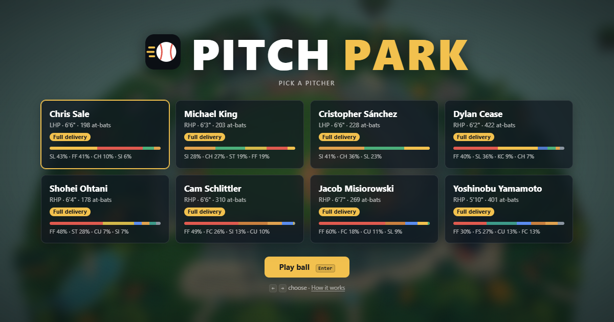

# Pitch Park

**Live site: [pitchpark.vercel.app](https://pitchpark.vercel.app)**



Pitch Park recreates real MLB pitchers' pitches and lets you watch them from the batter's box, in a
3D ballpark that runs in your browser. Every pitch comes from real Statcast tracking data, flown by
a physics engine and pitcher models built and tested in this repo.

The goal of the whole project: a simulated pitch should be statistically indistinguishable from a
real one thrown by the same pitcher.

## What you can do on the site

- **Pick a pitcher.** Eight are in: Dylan Cease, Michael King, Jacob Misiorowski, Shohei Ohtani,
  Chris Sale, Cristopher Sánchez, Cam Schlittler and Yoshinobu Yamamoto.
- **Replay mode.** Watch his real at-bats pitch by pitch from games the models never trained on.
  Each pitch can fly as Statcast tracked it, as our simulation, or both at once to compare.
  There are six camera views (umpire, batter, side, ride-along, free, TV), pitch trails and a
  "no spin" reference line.
- **Sim mode.** Face new at-bats the models make up: the pitch type is picked the way he picks
  them in that count, then generated, flown and aimed. Bat as a left- or right-handed hitter, and
  try to call ball or strike before it lands.
- **A moving pitcher.** Each pitcher's delivery is rebuilt from broadcast video, and the ball
  leaves his hand where Statcast says it did.

Press `?` on the site for all the keys.

## How it works

```
Statcast pitch data (Baseball Savant)
   │
   ├─ M1  physics: gravity, drag, Magnus force, per-game air density (RK4)
   ├─ M3  learned correction for movement spin alone can't explain
   ├─ M2  per-pitcher model of release point, speed and spin (Gaussian mixtures)
   ├─ M6  next-pitch model from the game situation (logistic regression)
   ├─ M5  3D delivery recovered from broadcast video (pose estimation)
   │
   └─ export: compact JSON per pitcher
         │
         └─ web/: Three.js + Vite static site on Vercel (no backend)
               └─ Sim mode runs a small JavaScript engine, kept identical to the
                  Python models by parity tests
```

All the heavy computation runs once, offline, in Python. The site only downloads the results and
plays them back, so it needs no server.

## Results at a glance

Every number is measured on games the models never saw. The full write-ups, including what is
still wrong, are in [`results/`](results/).

| Part | Check | Result |
|---|---|---|
| Flight (M1 + M3) | Median distance from where real pitches crossed the plate | 1.5–3.2 in, over 17 graded pitch types ([M3](results/M3.md)) |
| Pitcher model (M2) | Can a classifier tell real from generated pitches? | 6 of 9 graded pitch types pass against a real-vs-real baseline ([M2](results/M2.md)) |
| Look (M4) | Perceived velocity vs Statcast's `effective_speed` | Within 0.25 mph pooled ([M4](results/M4.md)) |
| Next pitch (M6) | Log loss vs count tendencies | 6–12% better on every held-out fold ([M6](results/M6.md)) |
| Sim at-bats (M7) | 20,000 simulated at-bats per pitcher vs real ones | 81% of 231 checks inside the real range ([M7](results/M7.md)) |
| Site | Frame time, umpire view | ~5 ms per frame; data cut 81% to 4.4 MB gzipped ([performance](results/web-performance.md)) |

## Run it locally

The exported data is committed, so the site runs without any Python:

```bash
cd web
npm install
npm run dev      # open the printed URL
npm test
```

To rebuild the data or rerun the experiments, set up Python 3.11+:

```bash
python -m venv .venv && source .venv/bin/activate   # Windows: .venv\Scripts\activate
pip install -e .[dev]
pytest -q
```

The sections below show how to reproduce each part.

## Tech

Python (NumPy, pandas, SciPy, scikit-learn, PyTorch for the transformer experiment), RTMPose and
HMR 2.0 for pose, JavaScript, Three.js and Vite for the site, hosted on Vercel. An optional MCP
server ([`scripts/mcp_server.py`](scripts/mcp_server.py)) lets AI assistants query the models.

---

# Reproducing the pipeline

## M1: the physics engine

```bash
# 1. Pull a season of real pitches (Baseball Savant, free)
python scripts/fetch.py --name "Tarik Skubal" --start 2025-04-01 --end 2025-09-30

# 2. Validate the physics against them
python scripts/validate.py data/raw/669373_2025-04-01_2025-09-30.csv
```

`scripts/validate.py` prints a table and writes `results/m1/<pitcher>/summary.csv` and
`report.png`. No network? `python -m pitchsim.synthetic` makes a fake pitcher
with known physics so you can run the pipeline anyway (calibration should
recover Cd = 0.35 and roughly the spin efficiencies listed in `src/pitchsim/synthetic.py`).

Three real pitchers, regular season only. The write-up is in [`results/M1.md`](results/M1.md).
To reproduce it:

```bash
python scripts/fetch.py --name "Shohei Ohtani" --start 2025-03-01 --end 2025-11-30
python scripts/fetch.py --name "Chris Sale" --start 2026-03-01 --end 2026-11-30
python scripts/fetch.py --name "Jacob Misiorowski" --start 2026-03-01 --end 2026-11-30
python scripts/validate.py data/raw/660271_2025-03-01_2025-11-30.csv
python scripts/validate.py data/raw/519242_2026-03-01_2026-11-30.csv
python scripts/validate.py data/raw/694819_2026-03-01_2026-11-30.csv
```

## M2: the pitcher model

A per-pitcher generative model of how a pitch leaves the hand (release point, extension,
velocity, spin rate, spin axis), scored by a classifier that tries to tell real held-out pitches
from generated ones (generated values are rounded like Statcast's first, or the classifier wins
on decimals alone). Pass means the model's AUC is within a noise-scaled margin of a
real-vs-real floor (real training-game pitches vs real held-out ones, same test; 0.60 to 0.68 in
8 of 9 graded rows, so a fixed 0.55 bar is unreachable). On the same three pitchers, 6 of 9
graded Gaussian pitch types pass; the fails are Misiorowski's slider (gap +0.130 vs margin 0.040),
and two near misses, Sale's changeup (+0.046 vs 0.043) and slider (+0.021 vs 0.020). Under the
old AUC <= 0.55 bar only 1 of 9 passes. The numbers, including a physical-units table
(mean and spread differences in ft, mph, rpm, degrees), are in [`results/M2.md`](results/M2.md). To reproduce it (cached CSVs from the M1 step):

```bash
python scripts/train_generative.py data/raw/660271_2025-03-01_2025-11-30.csv
python scripts/train_generative.py data/raw/519242_2026-03-01_2026-11-30.csv
python scripts/train_generative.py data/raw/694819_2026-03-01_2026-11-30.csv
```

This writes `results/m2/<pitcher>/` (summary, KS, context and physical-units CSVs, one PNG per pitch type).

## M3: movement spin can't explain

A learned constant push added to M1's flight, for the movement spin can't explain, on five
pitchers (the three above plus Cristopher Sánchez and Michael King, 2026). 14 of 17 graded pitch
types pass (median held-out miss drops by at least 0.6 in, 95% interval above zero); the fails are
Misiorowski's four-seamer and slider and King's slider. Graded medians go from 2.03–8.26 in to
1.49–3.15 in, 9 of 17 at or under 2 in and none at or under 1 in. The data mostly shows a fixed habit
per pitch type rather than a per-pitch effect (per-pitch beats fixed in 6 of 17), and the push isn't
shown to be seam force: it also holds a release-state artefact, and M1's efficiency can absorb much
of a push on the spin-force line. M1's efficiency lower bound moved from 0.20 to 0.01 during M3;
the old bound gave 16 of 17, but two of those passes were mostly repairing M1. The numbers and
synthetic controls are in
[`results/M3.md`](results/M3.md). To reproduce it:

```bash
python scripts/fetch.py --id 650911 --start 2026-03-01 --end 2026-11-30
python scripts/fetch.py --id 650633 --start 2026-03-01 --end 2026-11-30
python scripts/train_seam.py data/raw/<pitcher>.csv   # each of the five CSVs
python scripts/seam_controls.py                       # SYNTHETIC controls
python scripts/seam_bound_check.py                    # real data, old 0.20 bound vs new default
python scripts/seam_split_check.py                    # real data, four different game splits
```

This writes `results/m3/<pitcher>/` (summary and knock-on CSVs, one PNG per pitch type).

## M4: the batter's-eye viewer

M4 is a Three.js viewer of a stylised, code-built ballpark. You pick a pitcher and one of his
held-out at-bats, then watch each pitch fly in one of three ways: as Statcast's fit, as M1 + M3, or
both at once (ghost mode). There are six views (umpire, batter, side, ride, free, TV), a trail and
a no-spin reference line. A skinned pitcher's hand sits on the real release point.

Checks, all from [`results/M4.md`](results/M4.md):

- **Truth test:** the viewer reproduces the exported paths within 0.0025 in, over 3,400 real
  pitches.
- **Perceived velocity:** within 0.21–0.32 mph of Statcast's `effective_speed` per pitcher, on
  held-out games. This is after one reference extension was fitted on training games.
- **Approach angles:** no public Savant reference was found, so they rest on hand-worked tests.
- **Tunneling math:** unit-tested.

To run it:

```bash
python scripts/export_viewer.py data/raw/<pitcher>.csv [more.csv ...] --out web/public/data
cd web && npm install && npm run dev      # open the printed URL; press ? for keys
npm test                                  # truth and framing tests
python scripts/m4_checks.py data/raw/<pitcher>.csv [...]   # writes results/m4/checks.csv
```

Pass every pitcher's CSV to `export_viewer.py` in one run: it rewrites `web/public/data/index.json`
each time. The exported JSON is committed so the site builds on Vercel.

## M5: the moving pitcher

All eight pitchers in the viewer have a 3D delivery rebuilt from broadcast video and anchored to
Statcast's release. Release x/z and arm slot are compared with Statcast on held-out clips; extension
is not recoverable from a front-on camera and is constructed. Numbers per pitcher, and what is still
wrong, are in [`results/M5.md`](results/M5.md).

**Clips are for personal research only: never commit or redistribute them.** `data/` is gitignored,
and the viewer's compare page plays a clip from a file picker without serving or uploading it.

SMPL registration (licence): the 3D lifter needs the SMPL body model, which you must register for and
download yourself at <https://smpl.is.tue.mpg.de> (v1.1.0 `.pkl`; SMPL-X from <https://smpl-x.is.tue.mpg.de>
if you try other lifters). Put the files in `third_party/body_models/smpl/` (and `smplx/`), which is
gitignored. The setup script stops with a message if they are missing.

Commands, in order (Ohtani shown; `<slug>` is the clips folder name, e.g. `ohtani-shohei`):

```bash
pip install -e .[dev,video]                                  # 2D pose tools into the main .venv
# 1. Clips. The Savant clip server refuses scripted downloads, so save the clips in your browser:
python scripts/m5_fetch_clips.py data/raw/<pitcher>.csv --out data/video/<slug>   # writes clips.csv with a status per pitch
#    then save each mp4 as <game_pk>_<at_bat>_<pitch>.mp4 in data/video/<slug>/
# 2. 2D pose + centre-field screen + pitcher pick
python scripts/m5_pose2d.py data/video/<slug>/clips.csv
# 3. Hand labels: contact sheets, then fill src/pitchsim/pose/labels/<slug>_release_frames.csv
#    (and <slug>_foot_strike_frames.csv, <slug>_screen_overrides.csv)
python scripts/m5_label_frames.py sheets data/video/<slug>
# 4. 3D lift in its own environment (torch, CUDA GPU; needs the SMPL files above)
powershell -File scripts/setup_pose_env.ps1                  # makes .venv-pose
.venv-pose/Scripts/python.exe scripts/m5_lift.py data/video/<slug>/pose2d.csv
# 5. Build the delivery + accuracy metrics (writes results/m5/ and web/public/data/deliveries/)
python scripts/m5_build.py data/video/<slug> --raw data/raw/<pitcher>.csv
# 6. 2D replica-vs-clip comparison (writes results/m5/compare2d.csv and the fitted cameras)
python scripts/m5_compare2d.py data/video/<slug> --raw data/raw/<pitcher>.csv
# 7. Viewer data, then the viewer
python scripts/export_viewer.py data/raw/<pitcher>.csv ... --out web/public/data
cd web && npm run dev     # viewer: pick a pitcher on the start screen; compare.html = eye test
```

On `compare.html`, choose one of your local clips with the file picker; it plays beside the replica
from the TV camera, synced on the release frame. Hand labels are committed (frame numbers only); a
pitcher with no label files still builds, using the detector.

## M6: what he throws next

Predicts the next pitch type from the count, batter side, previous pitch and times through the
order, as probabilities to sample from. Games are split into 5 folds, so no game is in both
training and testing. Logistic regression beats the count baseline on every fold; gradient-boosted
trees tie it, and a small transformer does slightly worse. Write-up: [`results/M6.md`](results/M6.md).

```bash
python scripts/m6_evaluate.py      # baselines, logistic, boosted; calibration
python scripts/m6_transformer.py   # needs the seq extra: pip install -e .[seq]
```

## M7: Sim mode

Sim mode chains the models: M6 picks the pitch, M2 generates it, M1 + M3 fly it and M4 shows it.
`m7_export.py` writes the per-pitcher JSON the browser engine reads, and stops if the browser's
quick re-aim drifts more than 0.5 in from a full re-simulation. Write-up: [`results/M7.md`](results/M7.md).

```bash
python scripts/m7_export.py --all          # writes web/public/data/face/<slug>.json
python scripts/m7_real_stats.py --all      # real held-out at-bat stats
node scripts/m7_check.mjs --all            # simulated at-bats vs real
```

## MCP server

`scripts/mcp_server.py` exposes 11 read-only tools (arsenal, tunneling, plate error, pitcher
comparison, next-pitch odds, sampled and "what-if" pitches) to MCP clients such as Claude Code,
which picks it up from `.mcp.json`. Install with `pip install -e .[mcp]`.

## Files

| File | What it does |
|---|---|
| `src/pitchsim/physics.py` | Gravity + drag + Magnus force, RK4 integration. `simulate` (one pitch, full path) and `simulate_batch` (thousands at once, for fitting). Air density from temperature/elevation. |
| `src/pitchsim/statcast.py` | Turns Statcast's 9-parameter fit into a starting position/velocity at release (`release_state`) or y = 50 ft (`initial_state`), and gives the fit's own plate crossing. |
| `scripts/fetch.py` | Downloads a pitcher's pitches with `pybaseball`. |
| `scripts/validate.py` | The experiment: data check → convention check → default physics → calibrated physics → bias. |
| `src/pitchsim/generative.py`, `scripts/train_generative.py` | M2: the per-pitcher release model and its real-vs-generated test. |
| `src/pitchsim/seam.py`, `scripts/train_seam.py` | M3: learn the extra push per pitch type and per pitch, score it on held-out games. |
| `scripts/seam_controls.py` | M3 controls on synthetic pitches: what the method finds when the truth is known. |
| `scripts/seam_bound_check.py` | Record of the efficiency bound change: real results at the old 0.20 vs the new 0.01, plus the Spearman figures. |
| `scripts/seam_split_check.py` | M3: pass counts when a different set of games is held out (split seeds 0-3). |
| `src/pitchsim/tunneling.py`, `src/pitchsim/export.py`, `scripts/export_viewer.py` | M4: approach angles, perceived velocity, tunnel separation; held-out at-bats as JSON for the viewer. |
| `scripts/m4_checks.py` | M4 checks: perceived velocity vs `effective_speed`, approach angles per pitch type. |
| `src/pitchsim/pose/` | M5: video to 3D delivery (2D pose, lift, anchoring to Statcast). |
| `src/pitchsim/sequence/` | M6: pitch-selection models. |
| `src/pitchsim/face.py`, `scripts/m7_export.py` | M7: the pitch bank and export for Sim mode. |
| `src/pitchsim/mcp_tools.py`, `scripts/mcp_server.py` | The MCP server and the plain functions behind it. |
| `web/` | The site (Three.js + Vite): cameras, HUD, pitcher figure, park in `web/src/park/`, Sim engine in `web/src/face/`. |
| `src/pitchsim/synthetic.py` | Fake pitcher with known physics, for testing without the internet. |
| `tests/` | Checks against known numbers: ~0.4 s flight, ~8% speed loss, realistic rise, Coors effect. |

## How to read the M1 output

- **[0] fit vs plate** should be near 0 inches. If not, either coordinates are being read wrong
  or Statcast reports plate_x/z at a different y. 2026 data reports them mid-plate
  (y = 0.708 ft, also printed), not the front edge. Scoring uses the fit's own crossing,
  so results don't depend on it.
- **[1] spin_axis vs break direction** should be a few degrees. Confirms the spin sign convention.
- **baseline_err_in** — median miss at the plate using textbook constants.
- **cd, spin_eff** — fitted per pitch type. Spin efficiency is the share of spin that
  actually makes the ball move. Expect ~0.85–1.0 for four-seamers, much lower for
  gyro-heavy sliders and cutters.
- **calibrated_err_in** — median miss on *held-out* pitches. This is your headline number.
- **bias_x_in / bias_z_in** — average signed miss. A consistent miss in one
  direction is movement spin can't explain. That's what M3 (`results/M3.md`) adds a push for.

## Honest limitations

1. **The release start is anchored on Statcast's fit.** The simulator now starts at the
   release point, but the release position is `release_pos_*` and the velocity is the fit
   extrapolated back. That is not an independent measurement of release.
2. **Public `spin_axis` is Hawk-Eye-measured, not inferred from movement.** Confirmed 2026-10-30
   against Savant's spin-direction leaderboard: within ~7° of "measured", 4–33° off "inferred",
   across 15 pitch types (see `CLAUDE.md`). M3 reports its gap to the movement-implied axis
   next to the learned push; the two rise together only loosely.
3. **The constant-acceleration fit is itself an approximation.** On synthetic data
   it costs ~0.2–0.5 in and pulls fitted spin efficiencies slightly low, so treat
   anything under about half an inch as the noise floor.
4. **Air density is per game, but only from elevation and temperature.** No humidity,
   wind or pressure, and roofed games use the reported (indoor) temperature.
5. **Cd is constant.** In reality it depends on speed and spin.
6. **M3's push is "what's left after M1", not measured seam force.** It includes a release-state
   artefact (up to about 1 ft/s² on synthetic pitches), and M1's spin efficiency can absorb much of
   a push on the spin-force line, as far as it can move inside its 0.01–1.0 bounds, so a small
   residual doesn't prove there's no seam effect.

## References

- Alan Nathan's baseball physics site and trajectory calculator (the standard model used here).
- Baseball Savant's CSV documentation for column definitions.
- Barton Smith / Driveline research on seam-shifted wake, for M3.

## License and data

The code is released under the [MIT License](LICENSE).

The MLB pitch data comes from Baseball Savant (Statcast) and belongs to MLB Advanced Media; it is
not covered by the MIT License. This is an independent, non-commercial project, not affiliated with
or endorsed by MLB or any team. No broadcast video is included in this repository.
